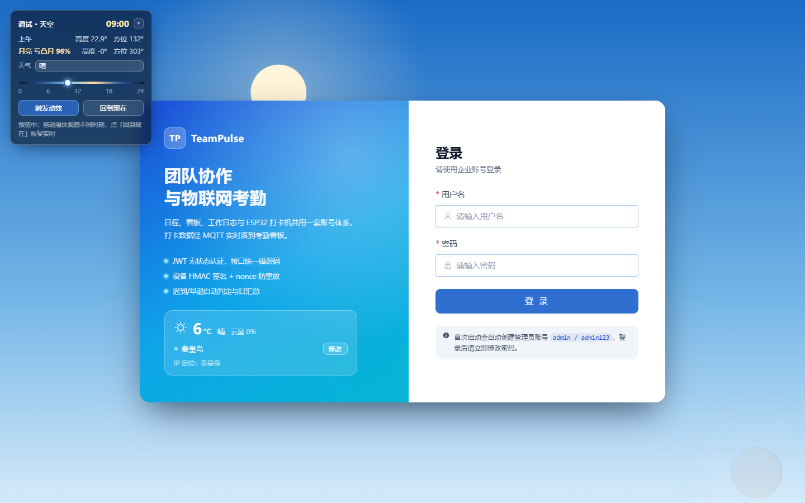
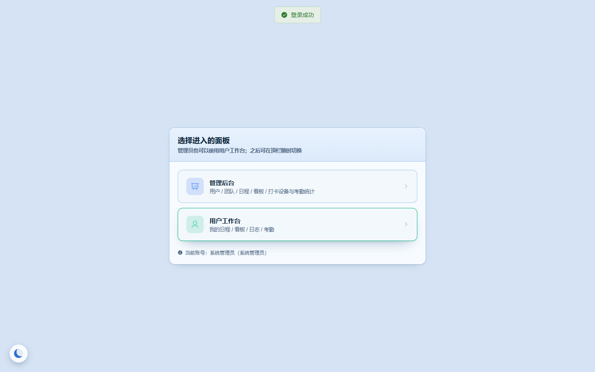
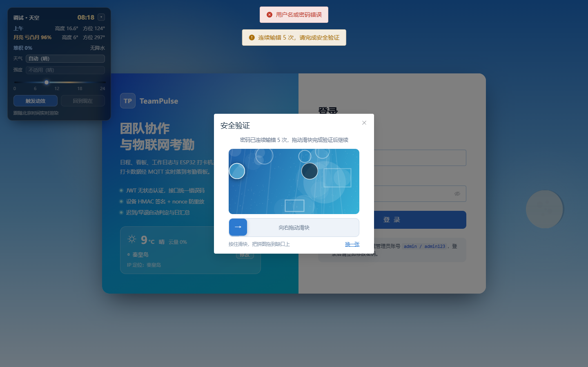

# TeamPulse

团队协作 + 物联网考勤，放在一个入口里：日程、看板、工作日志、评论、考勤、IoT 打卡机。

**演示地址**：http://www.team-pulse.site （域名备案中，也可用 http://180.76.235.34 ）
**演示账号**：`zhangsan` / `123456` —— 成员视角，只能看到自己那一摊数据
**管理员账号**：密码不公开，需要看管理端/审计日志的场景我可以现场给

> 演示环境是个人云服务器（4 核 3.7G），偶尔会为了调试或跑别的服务临时下线。
> 如果打不开，直接看代码和文档，或者联系我。



## 目录

- [3 分钟能验证什么](#3-分钟能验证什么)
- [它在解决什么问题](#它在解决什么问题)
- [功能一览](#功能一览)
- [技术栈](#技术栈)
- [架构与一次打卡的链路](#架构与一次打卡的链路)
- [怎么跑起来](#怎么跑起来)
- [目录结构](#目录结构)
- [几个值得看的实现](#几个值得看的实现)
- [测试与质量](#测试与质量)
- [真踩过的坑](#真踩过的坑)
- [关于 AI](#关于-ai)
- [现在还不行的](#现在还不行的)
- [文档](#文档)
- [关于我](#关于我)

## 3 分钟能验证什么

给面试官和好奇的人：不用读代码，按顺序点几下就能判断这东西是不是真能跑。

| 步骤 | 操作 | 你会看到 |
|---|---|---|
| 1 | 打开 `/login` | 登录页的背景按**当前北京时间**渲染天色（太阳/月亮位置、月相、星），左下角调试卡能拖时间轴预览任意时刻 |
| 2 | 用 `zhangsan / 123456` 登进去 | 先选面板（管理后台 / 用户工作台），进工作台后日程、看板、日志、考勤都在 |
| 3 | 故意错 5 次密码 | 第 6 次起会弹**服务端**滑块验证码；同一 IP 累计 10 次失败拉黑 10 分钟，页面会显示“失败 7 / 10”的实时计数 |
| 4 | 看考勤看板 | 迟到/早退判定、日汇总、补卡审批流；数据来自 `attendance_record` + `attendance_daily` 双表 |
| 5 | （可选）跑设备模拟器 | `node device/simulator/*.mjs`，会往 MQTT 发一条带 HMAC 签名的打卡报文，看板随即刷新 |




## 它在解决什么问题

起因很朴素：我先做过一个学校实训用的团队协作小系统（日程、看板、日志那套），做完发现三个问题——权限是写死的两张表、改个字段要手动动库、考勤全靠人手动填。

于是干脆重做一遍：换包名、权限拆成 6 个角色 22 个权限点、所有表结构走 Flyway 迁移、加审计日志、接了 ESP32 打卡机，最后容器化扔到腾讯云上。

现在它还在跑，我也拿它当面试作品——所以 `docs/` 里的东西写得比一般课程项目细得多。

## 功能一览

| 域 | 能力 |
|---|---|
| 认证与安全 | JWT 登录、刷新令牌、密码强度校验、连续失败触发验证码、IP 与账号双线失败计数、10 分钟 IP 拉黑（IP 只存加盐摘要） |
| 协作 | 日程（含跨天日历）、看板（列与卡片拖拽、卡片状态反写日程）、工作日志、评论（两级回复 + 敏感词过滤） |
| 考勤 | 考勤规则配置、打卡记录、迟到早退判定、日汇总、补卡申请与审批流、考勤看板与个人日历 |
| IoT | 设备注册与密钥、ESP32 经 MQTT 上报、HMAC-SHA256 验签、nonce 防重放、三层幂等、设备在线状态 |
| 权限 | 6 个角色 × 22 个权限点、部门树、数据范围（ALL / DEPT / SELF）、菜单与按钮按权限渲染 |
| 治理 | 操作审计日志（只增不改，5 组索引）、统一错误码、traceId 贯穿日志、Prometheus 指标 |

## 技术栈

| 层 | 选型 | 一句话理由 |
|---|---|---|
| 后端 | Spring Boot 3.2 / Java 17 / MyBatis-Plus 3.5 | 单模块分层（`module/<领域>`），不为 Service 写接口——只有一个实现，接口层是噪音 |
| 数据库 | MySQL 8 + Flyway | 20 张表全部走迁移，改结构不靠手改库 |
| 缓存 | Redis | MQTT nonce 去重（10 分钟窗口）、限流计数 |
| 消息 | Mosquitto（MQTT）+ Spring Integration | 设备侧协议轻、断网重连友好；不用 Kafka 是因为体量不值得 |
| 安全 | Spring Security 6 + JWT（jjwt）/ BCrypt | 无状态鉴权，`token_version` 递增可让旧凭证失效 |
| 前端 | Vue 3 + Vite 7 + Element Plus + ECharts | 没上 TypeScript——当时图快，现在有点后悔 |
| 部署 | Docker Compose 五容器 + Nginx 反代 | 单机够用；Prometheus / Grafana 在同一份 compose 里，靠 `--profile monitoring` 才拉 |
| 可观测 | Actuator + Micrometer | 暴露 health / metrics / prometheus，另有幂等命中、MQTT 连接等自定义指标 |
| 测试 | Playwright（E2E）+ 自写压测脚本 | 零额外依赖，Node 直接跑 |

## 架构与一次打卡的链路

```
浏览器 ──► Nginx(80) ──/api/──► backend(8080)
                              ├── MySQL 8      业务数据，20 张表 / 8 个迁移
                              ├── Redis        nonce 去重、限流计数
                              └── Mosquitto ◄── ESP32 打卡机（MQTT 1883）
```

```
ESP32 指纹模块 --UART--> 拼 JSON + HMAC-SHA256 签名 --> MQTT attendance/checkin
   --> Spring Integration 入站适配器
   --> 校验：设备存在 / 时钟漂移 ±300s / 签名一致 / nonce 未用过 / 三层幂等
   --> 判定签到或签退 + 迟到早退分钟数
   --> attendance_record（事件流，可审计）+ attendance_daily（日汇总，看板直查）
```

## 怎么跑起来

需要 Docker。最短路径：

```bash
cp .env.example .env          # 填 MySQL 密码、JWT_SECRET、管理员密码
docker compose up -d --build
# 打开 http://localhost ，健康检查 http://localhost/healthz
```

本地开发：

```bash
docker compose up -d mysql redis mosquitto   # 只起依赖

cd backend  && mvn spring-boot:run           # Java 17 + Maven
cd frontend && pnpm install && pnpm dev      # pnpm
```

两个容易踩的点：

- `.env` 的 `TPP_ADMIN_PASSWORD` 故意没有默认值：漏配直接报错，而不是悄悄用 `admin123` 建个弱口令管理员。
- mosquitto 的 `passwd` 必须能被容器内的 `mosquitto` 用户（uid 1883）读到，权限 `640` 且属主 1883；用 `mosquitto_passwd -c` 不会覆盖已存在的文件，要么先删、要么用 `-b`。

## 目录结构

```
backend/     Spring Boot，按 module/<领域> 分包；CONVENTIONS.md 是开发契约
frontend/    Vue 3；nginx.conf 是生产反代配置
device/      ESP32 固件（.ino）+ 设备模拟器（Node）
deploy/      部署、备份、发布脚本
docs/        14 份 Word 文档 + 11 份 Markdown
tests/ui/    72 个 Playwright 端到端脚本
tests/perf/  自写压测脚本（零依赖）
```

规模是自己数的：**136 个 Java 文件 / 11 352 行**，**19 个控制器 / 97 个 REST 接口**，**20 张表 / 8 个迁移**，**45 个 Vue 组件 / 19 156 行**。

## 几个值得看的实现

带着问题读代码比通读有效，这几个文件是项目的骨架：

| 想知道 | 看这里 |
|---|---|
| 权限怎么落到接口和数据上 | `backend/.../config/SecurityConfig.java` + `db/migration/V4__init_rbac_department.sql` |
| 审计日志怎么做到不改业务代码 | `module/audit/aspect/AuditLogAspect.java`（`@Around("@annotation(audited)")`） |
| 登录失败计数、验证码、拉黑 | `module/captcha/service/LoginGuardService.java` + `CaptchaService.java` |
| MQTT 验签与幂等 | `module/attendance/mqtt/*` + `AttendanceMetrics.java` |
| 统一响应与错误码 | `common/exception/ErrorCode.java` + `GlobalExceptionHandler` |
| 自定义指标 | `module/attendance/service/AttendanceMetrics.java`（30 行，幂等命中 / MQTT 连接） |

## 测试与质量

这个项目没有专职 QA，质量手段都是自己搭的：

| 资产 | 数量 | 说明 |
|---|---|---|
| Playwright 端到端脚本 | **72 个** | 权限矩阵、登录安全全链路、UI 对比度审计 |
| 接口断言 | **46 项**（容器）/ **42 项**（线上） | 权限矩阵、数据范围、打卡幂等、补卡审批、审计留痕、越权回归 |
| 权限矩阵用例 | **96 个** | 6 角色 × 16 条管理路由；结论：0 处“看得到摸不到”，7 处“无入口但接口可读”（已逐条评估） |
| 静态审计脚本 | **6 个** | 批量扫描不合规项（对比度、按钮权限、接口契约） |
| 缺陷 | **11 个** | 其中 2 个严重（越权、权限点为 0 全站不可点）、4 个部署阻断级；严重缺陷都补了回归断言 |
| 性能压测 | 20 并发 / 12s | RPS ≈ 190，p95 < 50ms，无失败；冷启动 p50 147ms / p99 282ms 单独记录 |

## 真踩过的坑

写这篇 README 时翻了一遍提交记录，挑几个印象深的。

**云朵画不出来。** 想给登录页加几朵云，在 canvas 里 `drawImage` 一个带 mask 的 SVG，画出空白。折腾半天才明白：SVG 里用了 mask/filter，栅格化会直接变透明。后来改成 DOM 层放 `` 让浏览器自己渲染，问题消失。

**登录页的积水会越积越厚。** 下雨时底部水位上涨，一开始挺对，雨下久了整屏都是水，切晴天也擦不掉。原因是叠加层 canvas 每帧只画不擦，旧水位一直留着。加一行 `clearRect` 就解决了——找了两个小时，改了一行。

**等满 10 分钟还是进不去。** 失败次数到阈值后拉黑 10 分钟，可冷却结束拿正确密码登录，还是被锁。因为冷却只解除黑名单，失败计数还停在 10，于是“需要验证码”→“拒绝”→又记一次失败→立刻二次拉黑。现在改成**拉黑的那一刻就把计数清零**，罚则交给黑名单的时间本身。

**改了代码，容器起来就崩，重启 10 次。** Maven 增量编译没重新编译我改的类，打出的 jar 里留着 `Unresolved compilation problems`；`mvn clean` 在离线环境又缺插件。最后手工删 `target/classes` 强制全量编译。教训：**打完包要确认它真的重新编译过**。

**整个站点突然全 401。** 首页、健康检查、接口全返回 401，容器却都“正常”。查下来是同一台机器上新装的一个面板占了 80 端口并强制 basic auth，流量根本没到 Nginx。教训：**端口归属是第一嫌疑**，`ss -lntp | grep :80` 比读日志快。

**MQTT 一直鉴权失败。** 客户端刷 `not authorised`。原因是 `passwd` 文件是很早生成的，和 `.env` 里的密码早已不一致；顺手把权限改成 640 后，容器内的 `mosquitto` 用户反而读不了，直接崩成重启循环。修完记了条规矩：改凭据文件时，**属主和权限要一起改**。

## 关于 AI

这个项目大部分代码是我和 AI 编程助手（DeepSeek Harness）一起写的，不打算藏着。

但我给自己立了规矩，也写进了仓库：

- **`backend/CONVENTIONS.md`**：176 行强制契约。包结构、统一响应、错误码怎么分配、当前用户 ID 必须从 JWT 取而不能从请求参数取、什么情况必须 `@Transactional`、新增模块的 7 条自检清单。AI 动手前先看这个。
- **`tests/ui/` 里 72 个脚本**：验收标准不是“看起来对”，是脚本跑绿。6 角色 × 16 路由的权限矩阵、登录安全全链路、UI 对比度审计都在里面。
- **一次只改一件事**：改完先跑脚本，绿了再进下一步。AI 说“已经改好了”的时候，往往才是排查的开始。

我的体会是：AI 能把“写”的速度拉高一个数量级，但**它不会替你判断什么算做完**。验收标准必须自己定，否则就是自己骗自己。

## 现在还不行的

- HTTPS 还没配（域名能开，但浏览器会提示不安全），ICP 备案也没做
- MQTT 走 1883 明文，8883 + TLS 没做
- 失败限流和验证码状态都在**进程内存**里，重启清零，多实例部署会失效（要换 Redis）
- 账号锁定、MFA、WAF 都没做
- 真实 ESP32 只跑过模拟器验证，量产固件（OTA、掉线重连策略）没硬化
- 备份只做了手工演练，没做定时任务
- 审计日志只做了写入与查询，归档和冷热分层没做
- Grafana 面板没配，指标只到“能被 Prometheus 抓到”这一步

## 文档

`docs/` 里有 14 份 Word：需求规格、总体设计、详细设计、数据库设计、接口文档、测试报告、运维手册、部署说明，还有一本系统图册（9 张图）。

最值得翻的三份：

- [`docs/TeamPulse_全过程交接文档.md`](docs/TeamPulse_全过程交接文档.md) —— 从老项目重构到上云的全过程与决策记录，包括做错的决定
- [`docs/登录体验与登录安全增强说明.md`](docs/登录体验与登录安全增强说明.md) —— 登录页天气系统、服务端验证码、IP 拉黑那一摊，坑都写在里面
- [`docs/性能测试报告.md`](docs/性能测试报告.md) —— 20 并发下的真实分位延迟，以及瓶颈在哪

## 关于我

徐国翔，燕山大学软件工程 23 级在读，2027 届。在找 Java 后端 / 测试开发方向的工作。

- 邮箱：xgxmailxgx@foxmail.com
- GitHub：[@The-prist](https://github.com/The-prist)
- 这个项目如果对你有用，star 随意；有问题提 issue，我会看。

---

License: MIT。代码随便用，但演示数据里的账号密码别照搬到生产。
